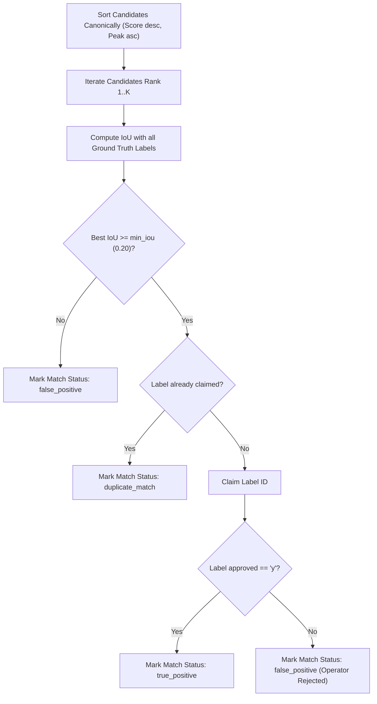

# StreamClip AI — Baseline Evaluation Metrics & Formulation

## 1. Overview

Stage 4A establishes a rigorous, quantitative evaluation framework to benchmark StreamClip AI's candidate highlight extractor and future AI Highlight Judge.

This framework shifts our evaluation from raw signal peak detection to **editorial accuracy**: measuring whether extracted clips match verified human standards for short-form entertainment value.

---

## 2. Mathematical Metric Formulations

### 2.1 Temporal Intersection-over-Union (IoU)

For a predicted candidate interval $C = [s_c, e_c]$ and a ground-truth annotation $G = [s_g, e_g]$, temporal overlap is measured by:

$$\text{Intersection}(C, G) = \max\Big(0,\; \min(e_c, e_g) - \max(s_c, s_g)\Big)$$

$$\text{Union}(C, G) = \max(e_c, e_g) - \min(s_c, s_g)$$

$$\text{IoU}(C, G) = \frac{\text{Intersection}(C, G)}{\text{Union}(C, G)}$$

A candidate $C$ is eligible to match ground truth $G$ if $\text{IoU}(C, G) \ge \tau$ (default threshold $\tau = 0.20$).

---

### 2.2 Precision@K

Measures the proportion of extracted candidates in the top-$K$ ranking that correspond to approved editorial moments:

$$\text{Precision@K} = \frac{\sum_{i=1}^{\min(K, N)} \mathbf{1}\big[\text{match\_status}(c_i) = \text{true\_positive}\big]}{\min(K, N)}$$

Where $N$ is the number of evaluated candidates.

---

### 2.3 Recall@K

Measures the fraction of all approved ground-truth highlights that were successfully captured in the top-$K$ candidates:

$$\text{Recall@K} = \frac{|\{g \in G_{\text{approved}} \mid g \text{ is claimed by some } c \in \text{Top-}K\}|}{|G_{\text{approved}}|}$$

---

### 2.4 Rating-Weighted Recall@K

Standard recall treats a 1-star borderline clip identically to a 5-star viral clip. Rating-weighted recall weights each ground-truth highlight by its human editorial rating $R(g) \in [1, 5]$:

$$\text{WeightedRecall@K} = \frac{\sum_{g \in G_{\text{claimed}}} R(g)}{\sum_{g \in G_{\text{approved}}} R(g)}$$

This penalizes the system severely if it misses a viral 5-star highlight, while being forgiving of missing low-priority 3-star clips.

---

### 2.5 Duplicate Rate

Detects when multiple candidate windows cluster around the same highlight, wasting editorial capacity:

$$\text{DuplicateRate@K} = \frac{\sum_{i=1}^{\min(K, N)} \mathbf{1}\big[\text{match\_status}(c_i) = \text{duplicate\_match}\big]}{\min(K, N)}$$

---

### 2.6 Boundary Accuracy (Mean and Median IoU)

Measures how closely the automated start and end timestamps match the human-defined editorial boundaries for all true positives:

$$\text{Mean IoU} = \frac{1}{|\text{TP}|} \sum_{m \in \text{TP}} \text{IoU}(m)$$

---

## 3. One-to-One Deterministic Matching Algorithm

To prevent multiple candidates from artificially inflating recall against a single highlight, StreamClip AI enforces **rank-ordered 1-to-1 matching**:



1. Candidates are ranked canonically using `canonical_ranking_key(score, unclipped_score, peak_seconds)`.
2. For each candidate in rank order, the label with highest $\text{IoU} \ge \tau$ is selected.
3. If the label was already claimed by a higher-ranked candidate, the candidate is classified as a `duplicate_match`.
4. If unclaimed:
   - If the label has `approved == "y"`, candidate is `true_positive`.
   - If `approved == "n"`, candidate is `false_positive` (tracking the operator's `rejection_reason`).
5. If no label overlaps above threshold $\tau$, candidate is `false_positive` (unmatched prediction).

---

## 4. Current Baseline Results

### 4.1 Measurement Summary (Synthetic Test Source)

Execution command:
```powershell
python -m app.evaluation evaluate \
  --candidates data/synthetic_vod/output/clips.json \
  --manifest data/evaluation/manifest.json \
  --out data/evaluation/baseline
```

| Metric | Result | Benchmark Interpretation |
| :--- | :---: | :--- |
| **Evaluated Candidates ($K$)** | 3 | Top 3 candidate windows extracted from source VOD. |
| **Ground Truth Pool** | 5 total | 3 approved highlights, 2 rejected dead-air/transit intervals. |
| **Precision@K** | **100.00%** | All 3 extracted candidates matched approved event moments. |
| **Recall@K** | **100.00%** | 3 out of 3 approved ground-truth events captured. |
| **Weighted Recall@K**| **100.00%** | Captured 100% of available editorial rating weight (12/12 stars). |
| **Approval Rate@K** | **100.00%** | 3/3 candidates meet human publishing standards. |
| **Duplicate Rate** | **0.00%** | Zero redundant duplicate predictions in top 3. |
| **Mean IoU** | **0.600** | Good alignment with editorial boundaries. |
| **Median IoU** | **0.533** | Median temporal boundary overlap. |

### 4.2 Category Performance
- `chaotic`: GT = 1, Matched = 1, Precision = 100%, Recall = 100%
- `fail`: GT = 1, Matched = 1, Precision = 100%, Recall = 100%
- `impressive`: GT = 1, Matched = 1, Precision = 100%, Recall = 100%
- `ordinary`: GT = 0, Matched = 0 (Both ordinary intervals were correctly rejected by detector)

---

## 5. Authentic Gameplay Baseline Status

> [!WARNING]
> **AUTHENTIC GTA GAMEPLAY BASELINE: PENDING AUTHORIZED FOOTAGE**
>
> In accordance with repository policy, no third-party copyrighted streamer footage has been downloaded without explicit rights.
> 
> The metrics reported in Section 4 reflect the end-to-end evaluation pipeline running against the local synthetic test suite to verify math, matching determinism, CSV/JSON reporting, and IoU calculations.
> 
> As soon as authorized GTA VOD recordings are ingested into `data/gameplay/`, the operator will label 20+ hours of gameplay using `app.evaluation annotate` to establish the official production baseline.
